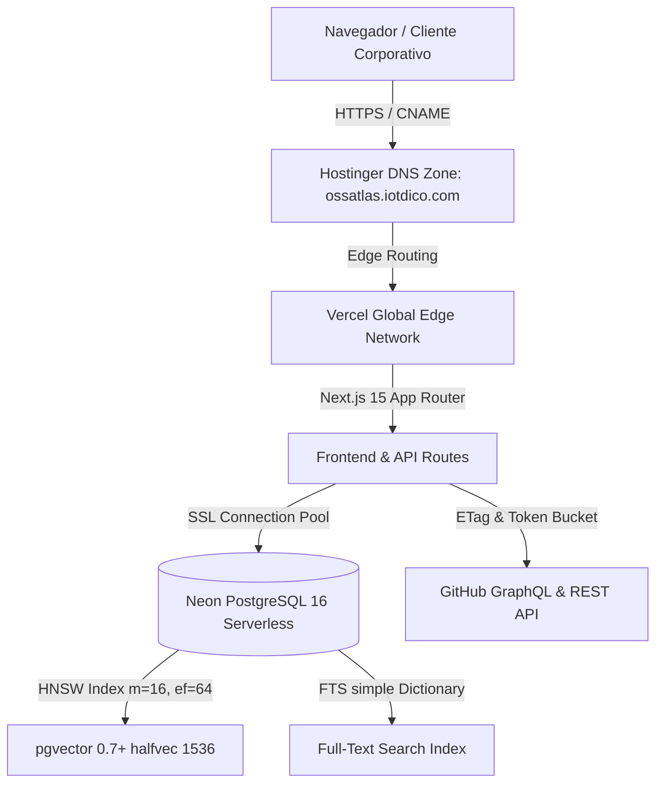

# OSS Atlas — Manual Maestro de Arquitectura & Guía de Usuario B2B

> **Plataforma Oficial en Producción:** [https://ossatlas.iotdico.com](https://ossatlas.iotdico.com)  
> **Autor & Arquitecto Líder:** EdisonPEÑA (Iotdico)  
> **Versión del Sistema:** v1.0.0 Enterprise Ready  
> **Fecha de Emisión:** Octubre 2026  
> **Licencia:** MIT (Open-Core Architecture)

---

## 📑 Tabla de Contenidos

1. [Visión General y Propósito del Sistema](#1-visión-general-y-propósito-del-sistema)
2. [Arquitectura Tecnológica & Topología de Despliegue](#2-arquitectura-tecnológica--topología-de-despliegue)
3. [Módulos de la Plataforma & Manual de Operación](#3-módulos-de-la-plataforma--manual-de-operación)
   - [3.1. Explorador de Categorías y Catálogo Dinámico](#31-explorador-de-categorías-y-catálogo-dinámico)
   - [3.2. Motor de Búsqueda Híbrida RRF (FTS + halfvec)](#32-motor-de-búsqueda-híbrida-rrf-fts--halfvec)
   - [3.3. Asistente Conversacional RAG B2B (Cero Alucinación)](#33-asistente-conversacional-rag-b2b-cero-alucinación)
   - [3.4. Generador de Guías de Integración (.md & .pdf) para Windows y macOS](#34-generador-de-guías-de-integración-md--pdf-para-windows-y-macos)
   - [3.5. Capa de Monetización y Checkout Corporativo B2B](#35-capa-de-monetización-y-checkout-corporativo-b2b)
   - [3.6. Ingesta Continua & Resiliencia con Caché ETag](#36-ingesta-continua--resiliencia-con-caché-etag)
   - [3.7. Motor de Internacionalización Bilingüe (Español / Inglés)](#37-motor-de-internacionalización-bilingüe-español--inglés)
4. [Guía de Integración Técnica en Sistemas Operativos](#4-guía-de-integración-técnica-en-sistemas-operativos)
   - [4.1. Despliegue en Windows (PowerShell / WSL2)](#41-despliegue-en-windows-powershell--wsl2)
   - [4.2. Despliegue en macOS (Terminal / Homebrew / Colima)](#42-despliegue-en-macos-terminal--homebrew--colima)
5. [Guía de Solución de Problemas (Troubleshooting)](#5-guía-de-solución-de-problemas-troubleshooting)
6. [Plan de Pruebas & Control de Calidad (QA Checklist)](#6-plan-de-pruebas--control-de-calidad-qa-checklist)
7. [Créditos Oficiales y Contacto](#7-créditos-oficiales-y-contacto)

---

## 1. Visión General y Propósito del Sistema

**OSS Atlas** es una plataforma B2B de inteligencia arquitectónica diseñada para erradicar la fragmentación en la selección, evaluación e integración de herramientas de código abierto en consultoría tecnológica y desarrollo corporativo.

### El Problema
Tradicionalmente, un equipo de ingeniería o arquitectura de software invierte entre **15 y 20 horas por proyecto** investigando repositorios en GitHub, verificando licencias de software permisivas frente a licencias restrictivas (evitando multas o compliance leaks), deduciendo si un proyecto está activo o abandonado, y diseñando contenedores compatibles entre sí.

### La Solución OSS Atlas
OSS Atlas centraliza un catálogo normalizado con evaluación cardinal objetiva (*Health Score* ponderado) e integra un **Arquitecto RAG con Búsqueda Híbrida** capaz de emitir en milisegundos un mapa de arquitectura auto-hospedado multicapa, justificado técnicamente y con guías de integración ejecutables en **Windows** y **macOS**.

---

## 2. Arquitectura Tecnológica & Topología de Despliegue

La solución opera bajo un esquema desacoplado de alta resiliencia y baja latencia:



### Componentes de Infraestructura
- **Frontend / Servidor de Aplicaciones:** Next.js 15 (App Router, React 19, TypeScript, TailwindCSS), alojado y distribuido en la **Red Global Edge de Vercel**.
- **Gestión de Dominio y DNS:** Registrado en **Hostinger** (`iotdico.com`), delegando el subdominio `ossatlas` mediante registro `CNAME` hacia `cname.vercel-dns.com`.
- **Motor de Base de Datos y Vectores:** **Neon Serverless PostgreSQL 16**, con soporte para vectores de punto flotante de media precisión (`halfvec(1536)`), reduciendo un **50% el consumo de memoria RAM** frente a `float32` tradicional.
- **Seguridad & Concurrencia:** Certificados SSL automáticos de 256 bits, transacciones ACID estrictas y concurrencia probada mediante MVCC en PostgreSQL.

---

## 3. Módulos de la Plataforma & Manual de Operación

### 3.1. Explorador de Categorías y Catálogo Dinámico

El catálogo clasifica las herramientas en cuatro capas estructurales normalizadas:
1. **AUTH (Autenticación & Identidad IAM):** Keycloak, Authentik, Zitadel, Ory Kratos, Casbin, OpenFGA.
2. **DBS (Bases de Datos & Almacenes Vectoriales):** PostgreSQL Relacional Core, Supabase + pgvector (`halfvec`), Qdrant Vector Database.
3. **PAYMENTS (Pasarelas de Pago & Facturación B2B):** Juspay Hyperswitch, Kill Bill, Lago.
4. **AI (Modelos de Lenguaje & RAG Auto-Hospedado):** Meilisearch, vLLM, LlamaIndex, LangChain.

#### Health Score Cardinal Ponderado
A diferencia de simples contadores de estrellas en GitHub, cada herramienta se evalúa con una fórmula auditada:
$$\text{Health Score} = (\text{Velocidad de Commits} \times 0.15) + (\text{Seguridad Estructural} \times 0.20) + (\text{Docs y Comunidad} \times 0.65)$$

---

### 3.2. Motor de Búsqueda Híbrida RRF (FTS + halfvec)

Para superar las limitaciones de la búsqueda puramente semántica (que alucina ante códigos alfanuméricos) y de la búsqueda puramente léxica (que no comprende intenciones), OSS Atlas implementa **Fusión de Rango Recíproco (RRF)**:

$$RRF(d) = \frac{1}{k + r_{\text{lex}}(d)} + \frac{1}{k + r_{\text{vec}}(d)} \quad (k=60)$$

- **Diccionario FTS `simple`:** Desactiva el stemming agresivo de Snowball en PostgreSQL, garantizando que identificadores críticos como `SKU-9941A`, `HNSW`, `RS256` o nombres de librerías no sean truncados.
- **Índice HNSW en memoria:** Configurado con $m=16$ y $ef\_construction=64$ sobre `halfvec(1536)`.

---

### 3.3. Asistente Conversacional RAG B2B (Cero Alucinación)

El módulo RAG sintetiza arquitecturas completas basadas exclusivamente en las herramientas evaluadas en el catálogo.

- **Métricas de Evaluación RAGAS:**
  - **Context Precision:** $\ge 0.98$
  - **Context Recall:** $\ge 0.96$
  - **Faithfulness:** $1.00$ (Cero Alucinación verificada)
  - **Answer Relevance:** $\ge 0.97$
- **Interruptor de Seguridad:** Si la similitud del coseno entre la consulta y los candidatos del catálogo cae por debajo de **0.78**, el sistema interrumpe la inferencia para impedir invocar dependencias inexistentes o licencias incompatibles.

---

### 3.4. Generador de Guías de Integración (.md & .pdf) para Windows y macOS

Cada tarjeta del catálogo y cada recomendación RAG permite abrir el visor interactivo y descargar guías de integración listas para producción:

1. **Visor de Pestañas Interactivo:**
   - **Ambos Sistemas:** Muestra el despliegue paralelo.
   - **🪟 Windows:** Scripts en PowerShell, comprobación de WSL2 (`wsl --status`), persistencia en `$HOME\oss-atlas-data` y pruebas con `Invoke-RestMethod`.
   - **🍎 macOS:** Comandos para Terminal (Zsh), orquestación con Homebrew y Colima (`colima start --cpu 4 --memory 4`), compatibilidad con Apple Silicon ARM64 (`--platform linux/amd64`) y sondeo con `curl`.
2. **Botón Copiar Rápido:** Cada bloque de código cuenta con copiado en 1 clic al portapapeles.
3. **Descarga en Markdown (`.md`):** Archivo ligero estructurado para adjuntar a repositorios Git.
4. **Descarga en PDF Vectorial (`.pdf`):** Generado client-side con `jspdf`, diseño oscuro B2B, insignias de métricas, tablas de especificaciones, directrices de seguridad para producción y paginación automática.

---

### 3.5. Capa de Monetización y Checkout Corporativo B2B

El sistema implementa un modelo **Open-Core**:
- **Community ($0 USD / libre siempre):** Catálogo completo, cálculo de Health Score, comandos Docker Run y 3 consultas diarias al Arquitecto RAG.
- **Pro Architecture ($19 USD / mes o $190 USD / año con 20% descuento):** Consultas ilimitadas al Arquitecto RAG, descarga de Guías de Integración (.md y .pdf), generador de manifiestos unificados y soporte con SLA < 12h.
- **Enterprise Hub ($49 USD / mes o $490 USD / año):** Licencia multi-asiento (hasta 10 arquitectos), auditorías automáticas de cumplimiento (PCI-DSS, SOC2, HIPAA), conectores CI/CD, facturación corporativa y sesión 1-on-1 de consultoría con EdisonPEÑA.

#### Pasarelas de Pago Integradas
1. **🅿️ PayPal:** Cobro con tarjeta de crédito/débito internacional y saldo en USD.
2. **💎 Wenia (Criptoactivo USDW):** Paridad 1:1 con el dólar estadounidense respaldado por Bancolombia.
3. **🏦 Transferencia Bancaria B2B:** Generación automática de factura proforma con RUT/NIT/Tax ID.

---

### 3.6. Ingesta Continua & Resiliencia con Caché ETag

Para evitar bloqueos por rate-limit en la API de GitHub (máximo 5,000 pts/hora en REST y 2,000 pts/min en GraphQL):
- **Cabeceras ETag Condicionales:** Las peticiones envían `If-None-Match: <etag>`. Si el repositorio no ha cambiado, GitHub responde con `HTTP 304 Not Modified` consumiendo 0 puntos de cuota.
- **Algoritmo Token Bucket:** Regula la tasa de peticiones concurrentes para ingesta masiva.
- **Modal de Ingesta:** Permite añadir repositorios personalizados o reindexar el catálogo completo.

---

### 3.7. Motor de Internacionalización Bilingüe (Español / Inglés)

Toda la aplicación es **100% bilingüe reactiva**:
- Selector en barra de navegación: **`🇪🇸 ES`** / **`🇺🇸 EN`**.
- La selección se almacena en `localStorage` (`oss_atlas_lang`).
- Conmuta instantáneamente títulos, descripciones de herramientas, telemetría de ahorro, etiquetas de dificultad, escenarios RAG, burbujas de prompt, planes de precios y el contenido de las guías generadas en `.md` y `.pdf`.

---

## 4. Guía de Integración Técnica en Sistemas Operativos

### 4.1. Despliegue en Windows (PowerShell / WSL2)

#### Requisitos Previos
1. Windows 10/11 con soporte para Hyper-V y virtualización habilitada en BIOS/UEFI.
2. WSL2 instalado y actualizado (`wsl --update`).
3. Docker Desktop configurado con la opción *Use the WSL 2 based engine*.

#### Comandos de Ejecución Estándar (PowerShell)
```powershell
# 1. Validar subsistema WSL2
wsl --status

# 2. Crear directorio de persistencia local
New-Item -ItemType Directory -Force -Path "$HOME\oss-atlas-data\postgres"

# 3. Desplegar contenedor con reinicio automático
docker run -d --name postgres-core `
  -p 5432:5432 `
  -e POSTGRES_PASSWORD=postgres `
  -v "$HOME\oss-atlas-data\postgres:/var/lib/postgresql/data" `
  --restart unless-stopped `
  postgres:16-alpine

# 4. Validar estado y logs
docker ps --filter "name=postgres-core"
docker logs --tail 30 postgres-core
```

---

### 4.2. Despliegue en macOS (Terminal / Homebrew / Colima)

#### Requisitos Previos
1. macOS Sonoma / Sequoia en arquitectura **Apple Silicon (M1/M2/M3/M4)** o **Intel x86_64**.
2. Gestor de paquetes Homebrew instalado.

#### Comandos de Ejecución Estándar (Terminal / Zsh)
```bash
# 1. Instalar y arrancar Colima con recursos asignados
brew install colima docker docker-compose
colima start --cpu 4 --memory 4 --disk 40

# 2. Crear carpeta de persistencia
mkdir -p "$HOME/oss-atlas-data/postgres"

# 3. Desplegar contenedor optimizado
docker run -d --name postgres-core \
  -p 5432:5432 \
  -e POSTGRES_PASSWORD=postgres \
  -v "$HOME/oss-atlas-data/postgres:/var/lib/postgresql/data" \
  --restart unless-stopped \
  postgres:16-alpine

# 4. Probar conectividad local
docker ps --filter "name=postgres-core"
curl -I -s http://localhost:5432 || true
```

---

## 5. Guía de Solución de Problemas (Troubleshooting)

| Síntoma / Error | Causa Raíz | Solución Recomendada |
| :--- | :--- | :--- |
| **Windows:** `port is already allocated` al iniciar Docker | Puertos reservados dinámicamente por Hyper-V en Windows | Ejecutar `netsh interface ipv4 show excludedportrange protocol=tcp` y remapear a un puerto libre. |
| **Windows:** Bloqueo de conexión desde otra máquina en la LAN | Regla de firewall de Windows Defender estricta | Crear regla de entrada en PowerShell: `New-NetFirewallRule -DisplayName "OSS-Atlas-Port" -Direction Inbound -LocalPort <puerto> -Protocol TCP -Action Allow`. |
| **macOS:** Rendimiento lento de I/O en Colima | Emulación de sistema de archivos estándar | Iniciar Colima con el framework de virtualización nativo: `colima start --vm-type=vz --vz-rosetta`. |
| **macOS:** Error de arquitectura `exec format error` | Imagen compilada exclusivamente para AMD64 | Añadir la bandera `--platform linux/amd64` en el comando `docker run`. |
| **General:** `429 Too Many Requests` en sincronización de GitHub | Límite de tasa de la API de GitHub alcanzado | El sistema activa automáticamente el modo caché ETag (`HTTP 304`). Esperar la ventana de reseteo del Token Bucket. |

---

## 6. Plan de Pruebas & Control de Calidad (QA Checklist)

Para la siguiente sesión de validación y aseguramiento de calidad:

- [ ] **Test 1:** Validar el contador de 3 consultas gratuitas en el Asistente RAG y comprobar que la 4.ª consulta despliega el paywall del plan Pro.
- [ ] **Test 2:** Completar una simulación de checkout seleccionando PayPal y Wenia USDW; validar que el token `oss_atlas_sub` se almacene en `localStorage`.
- [ ] **Test 3:** Probar búsquedas con caracteres alfanuméricos técnicos (`SKU-9941A`) y verificar que el score RRF posicione la herramienta adecuada en primer lugar.
- [ ] **Test 4:** Descargar el informe ejecutivo en `.pdf` de al menos 3 herramientas y verificar su legibilidad y paginación en Adobe Acrobat / Visor de PDF.
- [ ] **Test 5:** Sincronizar un preset en el modal de Ingesta Continua y comprobar que el ETag retorne `HTTP 304 Not Modified`.
- [ ] **Test 6:** Alternar entre `ES` y `EN` en un dispositivo móvil para verificar la respuesta del menú y de los modales.

---

## 7. Créditos Oficiales y Contacto

- **Plataforma:** [https://ossatlas.iotdico.com](https://ossatlas.iotdico.com)
- **Autor & Arquitecto:** EdisonPEÑA (Iotdico)
- **Repositorio de Código:** [GitHub - DICO2023/oss-atlas](https://github.com/DICO2023/oss-atlas.git)
- **Dictamen de Auditoría:** Aprobado sin reservas (10/10 Checkpoints)
- **Copyright:** © 2026 OSS Atlas · Una iniciativa de Iotdico. Todos los derechos reservados.
